<h1 align="center">🤖 JUWEL CHAT BOT</h1>

<b>WhatsApp বট · Mirai + GoatBot হাইব্রিড · ২৭০+ কমান্ড</b>

> Credit: 乛 M𝆠፝֟R ཐི༏ཋྀ JU𝆠፝֟W𝆠፝֟ELꜛཐི༏ཋྀ࿐

## ✨ কী কী আছে
- 📱 **WhatsApp** (Baileys) · কোড দিয়ে লগইন, `/pair` পেজে বড় করে কোড
- 🌐 **Render-এ শুধু ডিপ্লয়** — আপটাইম লিংক লাগে না, বট নিজেই জেগে থাকে
- 🔁 লগআউট/নষ্ট সেশন হলে নিজে নতুন লগইন শুরু করে
- 🧠 মেমোরি বেশি হলে নিজে বট-প্রসেস রিস্টার্ট (সেশন থাকে)
- 🎮 গেম, কুইজ, ইকোনমি · 👥 গ্রুপ ম্যানেজমেন্ট · 📥 মিডিয়া ডাউনলোডার
- 🖼️ ফটো এডিট ও ইমেজ জেনারেশন · 😂 ফান কমান্ড · 🕌 ইসলামিক প্যাক
- 🛡️ Anti-out / Anti-join / Anti-link ইত্যাদি সিকিউরিটি ইভেন্ট

## 🚀 চালানো
| কী | কোথায় |
|---|---|
| বটের নম্বর | `botnumber.js` |
| অ্যাডমিন (নম্বর + UID) | `config.json` → `ADMINBOT` |

বিস্তারিত ধাপ: **[SETUP.md](SETUP.md)**

## ⌨️ ব্যবহার
প্রিফিক্স `/` · `/help` · `/helpall` · `/menu`

## ⚙️ config.json
নাম, প্রিফিক্স, `ADMINBOT`, লগইন মোড (`code` | `qr` | `both`), বন্ধ রাখা কমান্ড/ইভেন্ট (`commandDisabled`, `eventDisabled`)।

## 📄 License
MIT — [LICENSE](LICENSE)
